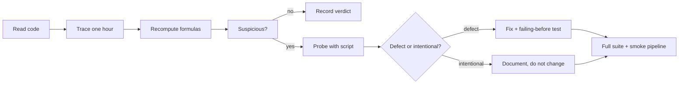

# GridMind — Audit Report

**Audit date:** 2026-11-25
**Repository:** `C:\Users\user\Documents\gridMind`
**Auditor role:** independent code and model audit against the implemented specification
**Verdict:** The project is structurally sound and all 151 tests pass. Ten confirmed correctness/stability defects and a set of documentation defects were fixed. Five behaviours that look like bugs but are intentional modelling choices were documented and deliberately **not** changed. Existing experiment artefacts predate the fixes and must be regenerated before their numbers are quoted.

---

## 1. Executive summary

| Item | Result |
| --- | --- |
| Modules audited | 30+ Python modules across core, agents, market, AI, experiments and UI |
| Baseline test result | `140 passed` in 7.06 s |
| Final test result | `151 passed`, 0 failed, 0 skipped, ~4 s |
| Regression tests added | 11 |
| Confirmed defects fixed | 10 functional + 5 documentation corrections |
| Intentional behaviours documented, not changed | 5 |
| Highest-severity defect | Central adapter could charge batteries with energy needed by load (and double-subtract served load) |
| Data-safety defect | A filtered smoke run could overwrite the official `docs/report/REPORT.md` |
| Artefact status | `results/` and `qtable.npy` predate the fixes; **stale** |
| Files deleted or rewritten wholesale | None |
| Git operations performed | None (working tree left uncommitted) |

The audit did not change the project concept, fleet, scenarios, metric definitions or official experimental design. Fixes are confined to execution correctness, random-stream hygiene, RL transition timing, report-path safety and documentation accuracy.

---

## 2. Scope and method

### 2.1 In scope

* `core/` — config, clock, weather, demand, supply, events, environment, model, logger, factory.
* `agents/` — base contract, consumer, producer, storage.
* `market/` — orders, auction, negotiation.
* `ai/` — central LP planner and adapter, tabular Q-learning, training loop.
* `experiments/` — runner, metrics, statistics, plots, report.
* `ui/` — app wiring, state, data loaders, views, components, charts.
* `tests/` — existing suite and coverage of edge cases.
* `config/` and `docs/contracts.md`, `docs/architecture.md` where they define behaviour.

### 2.2 Method

1. **Read the implementation, not the filenames or comments.** Every claim was checked against executable code.
2. **Trace each simulated hour end to end** through `GridModel._execute_step`, the market context, the auction/central adapter, settlement, agent updates, logging and snapshot.
3. **Recompute formulas independently** for metrics, statistics, LP objective, battery transitions and auction matching.
4. **Probe suspicious behaviour** with small scripts before changing anything (central execution, storage price history).
5. **Classify** each finding as a defect, an intentional modelling assumption, or an unknown.
6. **Fix defects only**, in priority order, with a regression test that fails on the pre-fix code.
7. **Re-run the full suite** and a small end-to-end pipeline into a temporary directory.

### 2.3 Severity scale

| Severity | Meaning |
| --- | --- |
| **High** | Wrong physical/economic outcome, corrupted learning data, or risk of destroying delivered artefacts |
| **Medium** | Misleading price/objective/history that affects interpretation or learning inputs |
| **Low** | Documentation or metadata incorrect, no runtime effect |
| **Info** | Behaviour reviewed and judged intentional; documented only |



---

## 3. Baseline and final validation

### 3.1 Test suite

| Stage | Command | Result |
| --- | --- | --- |
| Baseline, before changes | `.venv\Scripts\python.exe -m pytest -q` | `140 passed in 7.06s` |
| After all fixes | same | `151 passed in 3.94s` |
| Targeted regression subset | `pytest tests/test_market.py tests/test_agents.py tests/test_model.py tests/test_experiments.py -k "..."` | `11 passed, 49 deselected` |
| Collection check | `pytest --collect-only -q` | `151 tests collected` |

Test distribution after the audit:

| File | Tests |
| --- | --- |
| `tests/test_config.py` | 31 |
| `tests/test_model.py` | 24 |
| `tests/test_environment.py` | 17 |
| `tests/test_market.py` | 13 |
| `tests/test_agents.py` | 12 |
| `tests/test_clock.py` | 11 |
| `tests/test_experiments.py` | 11 |
| `tests/test_ai.py` | 10 |
| `tests/test_logger.py` | 7 |
| `tests/test_factory.py` | 6 |
| `tests/test_reproducibility.py` | 6 |
| `tests/test_contracts.py` | 3 |

### 3.2 End-to-end smoke pipeline (executed)

```bat
.venv\Scripts\python.exe -m experiments.runner --seeds 1 ^
  --systems auction central_1h --scenarios normal ^
  --output C:\Users\user\AppData\Local\Temp\opencode\gm_smoke --quiet
```

Result: 2 experiments, 168 steps each, ~1.7 s; produced `runs/`, `raw.csv`, `steps.csv` (238 KB), `metrics_summary.csv`, `stats_pairwise.csv`, `run_metadata.json`, six figures and `REPORT.md` **inside the temporary directory**. The official report was not touched. This verifies the report-path fix and the whole metrics → stats → figures → report chain on post-fix code.

### 3.3 Targeted probes (executed)

* Default `central_1h`, `t = 0`: supply 85 MW, demand 44.02 MW, served 31.99 MW, unserved 12.03 MW, charge 0 MW, price 45.0. Confirms the intentional factory shedding (VOLL 40 < thermal cost 45) and that charging does not pre-empt load.
* Enlarged fleet (thermal 400 MW, wind 200 MW): `central_1h` and `central_6h` charge only from surplus and serve load fully.
* Storage observations after the price-history fix: `avg_price_24h` at `t = 1` equals the settled price from `t = 0`, whereas before the fix it lagged by one hour.

---

## 4. Module inventory and verdicts

| Module | Responsibility | Verdict |
| --- | --- | --- |
| `core/config.py` | YAML load, strict validation, official constants, seed derivation | Sound; added forecast stream helper |
| `core/clock.py` | 168-hour clock, hour/day mapping | Sound |
| `core/weather.py` | Temperature, cloud, wind, solar profile, noiseless forecast | Sound; documented forecast assumptions |
| `core/demand.py` | Expected and realised demand by consumer type | Sound; independent streams |
| `core/supply.py` | Solar/wind/thermal/peaker availability | Sound; solar×cloud semantics documented |
| `core/events.py` | Event model, modifiers, activation windows | Sound |
| `core/environment.py` | Composition, modifier application, forecast | Sound |
| `core/model.py` | Nine-stage orchestration, observations, context, logging | Sound; snapshot semantics documented |
| `core/logger.py` | Stable step log plus dynamic per-agent columns | Sound |
| `core/factory.py` | Assembles model for system/seed/scenario | Sound |
| `agents/base.py` | Frozen agent contract | Sound |
| `agents/consumer.py` | Bidding and forecast error | **Fixed** (forecast stream) |
| `agents/producer.py` | Offer price and markup adaptation | Sound |
| `agents/storage.py` | Physics, rule policy, action caching | **Fixed** (once-per-hour, price history) |
| `market/orders.py` | Frozen `Order`/`Trade` | Documentation fixed (priority direction) |
| `market/auction.py` | Clearing, uniform price, settlement | Sound; price docstring fixed |
| `market/negotiation.py` | Round/ceiling validation, ordering | Sound |
| `ai/central_lp.py` | LP planner, cached execution, central price | **Fixed** (4 defects) |
| `ai/qlearning.py` | State discretisation, Q-update, greedy policy | Sound |
| `ai/train.py` | Offline training, artefacts | Sound |
| `experiments/runner.py` | 600-run grid, aggregates, metadata | **Fixed** (report path, curve metadata) |
| `experiments/metrics.py` | Official metrics | Sound; docstring fixed |
| `experiments/stats.py` | Bootstrap, Wilcoxon, Bonferroni | Sound |
| `experiments/plots.py` | Six figures | Sound |
| `experiments/report.py` | Markdown report | **Fixed** (dynamic test count) |
| `ui/state.py` | Live model lifecycle, error surfacing | Sound |
| `ui/data.py` | Artefact loading with empty states | Sound |
| `ui/views/*`, `ui/components.py`, `ui/charts.py` | Four dashboard pages | Sound; snapshot semantics documented |

---

## 5. Confirmed defects and fixes

### D1 — Central execution could charge batteries with energy needed by load — **High**

* **Module:** `ai/central_lp.py::CentralMarketAdapter._execute`
* **Symptom:** In hours where the cached plan charged a battery, the adapter could allocate charging before fully serving actual demand, leaving load unserved while the battery charged. The "available" quantity could also double-subtract the served load.
* **Root cause:** Charge was subtracted from supply before consumer allocation, and the served quantity was subtracted again when computing the remaining available energy.
* **Fix:** Compute total supply as `generation + discharge`, determine surplus relative to actual demand, force charge to zero when demand ≥ supply, cap each battery's charge by its planned charge and by the surplus, scale charging down if the sum exceeds surplus, and derive `available = supply - total charge`. Consumers are then served in descending VOLL order from `available`; charging never consumes energy that load needs.
* **Files:** `ai/central_lp.py`
* **Regression tests:** `test_central_execution_serves_load_before_charging`, `test_central_execution_never_charges_while_load_is_unserved`
* **Validation:** Direct probe at `t = 0` shows zero charge and 12.03 MW factory unserved; enlarged-fleet probe shows load fully served and charge only from surplus.

### D2 — Central execution ignored actual battery physical limits — **High**

* **Module:** `ai/central_lp.py::CentralMarketAdapter._execute`
* **Symptom:** A cached plan computed several hours earlier could discharge more than the battery actually held, or charge beyond available headroom, creating or destroying energy relative to the plan.
* **Root cause:** The plan was executed verbatim; no execution-time clipping against the actual state of charge or headroom.
* **Fix:** Clip discharge to `min(rate, soc_mwh · η)` and charge to `min(rate, headroom_mwh / η)` at execution time, using cached `_storage_specs` for capacity, rate and efficiency.
* **Files:** `ai/central_lp.py`
* **Regression tests:** `test_central_execution_clips_charge_to_physical_headroom`, `test_central_execution_clips_discharge_to_available_energy`
* **Validation:** Both tests construct a plan that violates the physical limit and assert the executed flow is clipped.

### D3 — Central price could be set by unsold or curtailed generation — **Medium**

* **Module:** `ai/central_lp.py::CentralMarketAdapter._execute`
* **Symptom:** The uniform central price could reflect the marginal cost of a unit that was dispatched in the plan but did not actually match demand after clipping, or of generation that was curtailed.
* **Root cause:** Price was taken as the maximum cost over all dispatched/available sellers rather than over sellers with matched quantity.
* **Fix:** Price is now the maximum marginal cost among sellers that actually matched in the execution allocation. If nothing matches, the previous price is kept.
* **Files:** `ai/central_lp.py`
* **Regression test:** `test_central_price_excludes_curtailed_generation`
* **Limitation retained:** This is still a marginal-cost proxy, not the LP dual. Documented, not changed.

### D4 — `DispatchPlan.objective` duplicated the whole-horizon objective in every hour — **Medium**

* **Module:** `ai/central_lp.py::DispatchPlan`, planner construction
* **Symptom:** Summing `plan.objective` over a horizon multiplied the cost by the number of hours; per-hour reporting was wrong.
* **Root cause:** The full LP objective value was copied into every hourly `DispatchPlan`.
* **Fix:** Each plan stores its own cost slice `np.dot(cost[base:base+block], values[base:base+block])`, so summing a horizon equals `CentralLPPlanner.last_objective`.
* **Files:** `ai/central_lp.py`
* **Regression test:** `test_central_plan_objectives_sum_to_the_horizon_total`

### D5 — Consumer forecast noise shared the realised-demand stream — **Medium**

* **Module:** `agents/consumer.py`, `core/config.py`
* **Symptom:** A consumer's "forecast error" was drawn from the same stream family as the demand model's realised shock for the same agent, creating spurious correlation between what the agent expected and what the environment produced.
* **Root cause:** Both draws used `derive_agent_rng(seed, agent_id)`.
* **Fix:** Added `STREAM_AGENT_FORECAST_BASE = 2_000_000` and `derive_agent_forecast_rng(seed, agent_id)`; `ConsumerAgent` now uses it. Forecast and realised-demand streams are independent.
* **Files:** `core/config.py`, `agents/consumer.py`
* **Regression test:** `test_consumer_forecast_noise_uses_an_independent_stream`
* **Note:** This changes the realised numbers of any future run (not the design). Existing artefacts therefore cannot be mixed with post-fix runs.

### D6 — Storage policy was queried once per negotiation round — **High**

* **Module:** `agents/storage.py`
* **Symptom:** In auction modes, the battery policy was evaluated in rounds 1, 2 and 3 of the same hour. A learning policy would close multiple transitions from the same state and attribute the whole hour's reward to the last round.
* **Root cause:** `StorageAgent.decide(round)` called `policy.act()` on every invocation.
* **Fix:** Added `_step_action`, reset in `_on_observe`; the policy is queried once per hour and the cached action is reused for later rounds. Comment added to make the invariant explicit.
* **Files:** `agents/storage.py`
* **Regression test:** `test_storage_policy_is_queried_once_per_hour_across_rounds`
* **Impact:** This is a learning-correctness and reproducibility fix; it affects `auction_q` behaviour and any future training.

### D7 — Storage price history lagged by one hour — **Medium**

* **Module:** `agents/storage.py`
* **Symptom:** The policy's `avg_price_24h` did not include the most recently settled clearing price when it was queried at the next hour, because the append happened during `observe()` after the snapshot.
* **Root cause:** `_last_price` was appended to `_price_history` in `_on_observe`.
* **Fix:** Append moved to `_on_update` (after settlement); `_on_observe` now only resets `_step_action`. Comments/docstrings updated.
* **Files:** `agents/storage.py`
* **Regression tests:** `test_storage_price_history_records_the_settled_price`, `test_storage_policy_observation_includes_the_latest_clearing_price`
* **Validation:** Probe shows `avg_price_24h` at `t = 1` equals the `t = 0` settled price.

### D8 — A filtered run could overwrite the official report — **High (data safety)**

* **Module:** `experiments/runner.py`
* **Symptom:** Any run, including a one-seed smoke test, wrote `docs/report/REPORT.md`, destroying the delivered 600-run report.
* **Root cause:** Report destination was hard-coded to the documentation folder.
* **Fix:** Added a `report_path` parameter and `_report_destination(specs)`: the official full grid written to `results/` writes `docs/report/REPORT.md`; filtered or alternative-output runs write `<output_dir>/REPORT.md`; an explicit `report_path` overrides both.
* **Files:** `experiments/runner.py`
* **Regression tests:** `test_partial_run_report_never_overwrites_the_official_report`, plus `test_report_generation_keeps_hypotheses_and_calibration_caveat`
* **Validation:** Smoke pipeline wrote `REPORT.md` inside the temporary output directory.

### D9 — Learning-curve metadata always pointed at the global curve — **Low**

* **Module:** `experiments/runner.py`
* **Symptom:** Metadata recorded the global `results/learning_curve.csv` even when a run directory contained its own curve, misrepresenting provenance.
* **Root cause:** A single hard-coded path.
* **Fix:** `_load_learning_curve(*directories)` now checks the run output directory first, then the global results directory, returning `(path, frame)`; metadata records both `learning_curve` and `learning_curve_loaded`.
* **Files:** `experiments/runner.py`
* **Validation:** Smoke `run_metadata.json` records the global curve and `learning_curve_loaded: true` only because the run directory had none; the lookup order is covered by the code path exercised in the smoke run.

### D10 — Report prose hard-coded "360 tests" — **Low**

* **Module:** `experiments/report.py`
* **Symptom:** The generated report stated a fixed Bonferroni comparison count even when the number of tested pairs differed.
* **Root cause:** Literal `360`.
* **Fix:** Use `pairwise["bonferroni_tests"].iloc[0]`.
* **Files:** `experiments/report.py`
* **Validation:** Report generation test passes; pairwise table contains the dynamic count.

### D11 — Documentation contradicted the code — **Low**

| Location | Wrong statement | Corrected to |
| --- | --- | --- |
| `market/orders.py` | Priority "higher values are served first" | Lower values are served first; hospital 1 … flexible 4 |
| `market/auction.py` | `ClearingResult.price` described as quantity-weighted | Uniform midpoint of the last matched bid/ask |
| `docs/contracts.md` | Priority comment "higher served first" | Lower served first (hospital 1 … flexible 4) |
| `experiments/metrics.py` | Docstring listed a non-existent `extra` parameter | Removed |
| `README.md` | "140 passed" | Updated to 151 |

These had no runtime effect but would have misled a reader or examiner about the mechanism.

---

## 6. Intentional behaviours documented, not changed

These were investigated and judged to be modelling choices, not defects. Changing them would have altered the calibrated study.

### I1 — Central dispatch sheds factory load

**Observation:** The LP leaves factory demand unserved while thermal capacity is available.
**Why intentional:** VOLL(factory) = 40 < thermal marginal cost 45, so shedding lowers the configured social cost. It is the rational outcome of the specified preferences.
**Consequence:** Central and auction systems are not compared on identical served energy. UE by type and hospital outage hours must accompany social cost.
**Documented in:** technical documentation §8.2, academic guide Q18/Q47.

### I2 — Central recovery is often censored

**Observation:** `recovery_time` for central systems saturates at `steps - start`.
**Why intentional:** The standing factory shortfall keeps total UE above 0.001 MW, so the three-consecutive-hour criterion never fires. The metric correctly reports censoring rather than inventing a recovery.
**Documented in:** technical documentation §10.3, academic guide Q36/Q37.

### I3 — Solar output is multiplied by cloud cover

**Observation:** `weather_shift` sets `cloud_override: 0.2`, which *reduces* solar output.
**Why intentional:** The implemented variable behaves as a solar availability factor. Changing the equation would change scenario calibration and all historical results.
**Documented in:** technical documentation §5.3, academic guide Q33.

### I4 — Deferred energy that fails to rebound is not re-counted

**Observation:** Settlement compares the shortfall against metered demand, which excludes the re-bid.
**Why intentional/limitation:** It is a definitional consequence of measuring UE against environment demand. It is documented as a limitation; changing it would change the UE definition.
**Documented in:** technical documentation §7.2, academic guide Q15.

### I5 — Snapshot mixes next-hour clock with last-completed results

**Observation:** `snapshot()["t"]` is the next hour, while `price`, `unserved`, `deferred` and `active_events` describe the last completed step / the next hour respectively.
**Why intentional:** The dashboard needs progress plus the last clearing result; the contract is documented and tested, and the UI labels it accordingly. Changing it would break the dashboard contract.
**Documented in:** technical documentation §11, `docs/contracts.md`.

---

## 7. Tests added by the audit

All eleven tests fail on the pre-fix code and pass after the fixes.

| # | Test | File | Defect |
| --- | --- | --- | --- |
| 1 | `test_central_execution_serves_load_before_charging` | `tests/test_market.py` | D1 |
| 2 | `test_central_execution_never_charges_while_load_is_unserved` | `tests/test_market.py` | D1 |
| 3 | `test_central_execution_clips_charge_to_physical_headroom` | `tests/test_market.py` | D2 |
| 4 | `test_central_execution_clips_discharge_to_available_energy` | `tests/test_market.py` | D2 |
| 5 | `test_central_price_excludes_curtailed_generation` | `tests/test_market.py` | D3 |
| 6 | `test_central_plan_objectives_sum_to_the_horizon_total` | `tests/test_market.py` | D4 |
| 7 | `test_storage_policy_is_queried_once_per_hour_across_rounds` | `tests/test_agents.py` | D6 |
| 8 | `test_storage_price_history_records_the_settled_price` | `tests/test_agents.py` | D7 |
| 9 | `test_consumer_forecast_noise_uses_an_independent_stream` | `tests/test_agents.py` | D5 |
| 10 | `test_storage_policy_observation_includes_the_latest_clearing_price` | `tests/test_model.py` | D7 integration |
| 11 | `test_partial_run_report_never_overwrites_the_official_report` | `tests/test_experiments.py` | D8 |

No existing test was modified to make a fix pass.

---

## 8. Executed vs not executed

### 8.1 Executed during this audit

* Full pytest suite before changes (140 passed) and after changes (151 passed).
* Targeted run of the 11 new regression tests.
* Collection check confirming 151 tests.
* Full metrics → statistics → figures → report pipeline on 2 real runs into a temporary directory.
* Central execution probes on the default fleet and an enlarged fleet.
* Storage price-history probe before and after the fix.
* Q-table shape/non-zero inspection: `(60, 3)`, 180 non-zero entries.
* Repository-wide search for placeholder/TODO markers.

### 8.2 Not executed during this audit

* A fresh 2000-episode Q-learning run.
* A fresh official 600-run grid.
* A manual Streamlit browser session (the existing UI test coverage is via AppTest-style checks in the prior work, not a human visual review in this audit).
* Any validation against real grid, weather or market data.
* Performance profiling beyond the observed ~1 s per 168-step run.

These are **not** claimed as verified. Their absence is the reason the existing artefacts are marked stale.

---

## 9. Artefact status and regeneration

| Artefact | Status | Consequence |
| --- | --- | --- |
| `qtable.npy` | Pre-fix | `auction_q` results and the Learning page reflect the old transition timing |
| `results/learning_curve.csv` | Pre-fix | Training curve not comparable to post-fix learning |
| `results/raw.csv`, `steps.csv`, summaries | Pre-fix | Aggregate numbers do not include D1–D7 changes |
| `docs/report/REPORT.md` | Pre-fix | Prose/tables generated from pre-fix metrics |
| `results/figures/*` | Pre-fix | Figures reflect pre-fix runs |

Regeneration order (deliberately **not** run, to avoid overwriting delivered artefacts without the author's decision):

```bat
.venv\Scripts\python.exe -m pytest -q
.venv\Scripts\python.exe -m ai.train
.venv\Scripts\python.exe -m experiments.runner --seeds 30
.venv\Scripts\streamlit.exe run ui/app.py
```

Do **not** mix pre-fix and post-fix artefacts in one table. If only a smoke run is needed, always pass `--output <temp dir>`; the report-path fix keeps `docs/report/REPORT.md` safe, but `raw.csv`/`steps.csv` are still rewritten inside the chosen output directory.

---

## 10. Residual risks and unresolved issues

| ID | Risk | Severity | Status |
| --- | --- | --- | --- |
| R1 | A filtered run pointed at `results/` still overwrites `raw.csv`, `steps.csv`, `metrics_summary.csv`, `stats_pairwise.csv` | Medium | Documented; only the report path is auto-protected. Recommend a `--dry-run`/manifest check or writing aggregates to a run-scoped subdirectory. |
| R2 | Central price is a marginal-cost proxy, not the LP dual | Medium | Documented as a limitation; not changed because the alternative would alter reported prices. |
| R3 | Auction deferred energy that fails to rebound is not traced | Medium | Documented as a settlement-definition limitation. A future extension could carry a `rebound_failed` component without changing total UE. |
| R4 | Central/auction comparison is not like-for-like on served energy | High (interpretive) | Documented; mitigation is to report UE by type and hospital outage hours, and optionally run a VOLL sensitivity study. |
| R5 | Existing artefacts are stale | High (reporting) | Documented; regenerate before quoting numbers. |
| R6 | Q-learning state space and reward are coarse | Medium | Intentional scope; documented in limitations. |
| R7 | No network/unit-commitment/reserve modelling | High (external validity) | Out of scope; documented. |
| R8 | Partial interruption can leave truncated CSVs | Medium | `run_metadata.json` records the selected grid; verify before aggregating. |
| R9 | No post-fix 600-run validation was executed | High (verification gap) | Explicitly listed; not claimed. |
| R10 | UI was not manually exercised in this audit | Low | Static review only; prior AppTest evidence exists but is not re-verified here. |

---

## 11. Recommendations

1. **Regenerate everything once**, in the order training → 600-run grid → report, and archive the pre-fix artefacts if they are cited anywhere.
2. **Add a run manifest check** that refuses to write aggregates into `results/` unless all 600 official runs are selected.
3. **Report UE by consumer type and hospital outage hours** next to social cost, so the factory-shedding asymmetry cannot be misread.
4. **Run a VOLL sensitivity study** (e.g. factory VOLL 40 vs 60) as a clearly labelled new experiment, not a silent change.
5. **Trace deferred rebounds explicitly** in a future metric (e.g. `deferred_failed_mwh`) without altering the official UE definition.
6. **Keep the regeneration commands in the README** and state the exact Q-table hash used for `auction_q`.
7. **Add a dashboard smoke test** that renders each page with missing and present artefacts.

---

## 12. Change inventory

### 12.1 Functional changes

| File | Change |
| --- | --- |
| `ai/central_lp.py` | Execution allocation rewritten (serve load first, charge from surplus only); storage plans clipped to physical limits; price from matched sellers; per-hour objective slices; removed unused `_capacity` |
| `core/config.py` | Added `STREAM_AGENT_FORECAST_BASE` and `derive_agent_forecast_rng` |
| `agents/consumer.py` | Forecast noise uses the independent stream |
| `agents/storage.py` | Policy queried once per hour (`_step_action`); price history appended in `_on_update` |
| `experiments/runner.py` | `report_path` parameter, safe destination logic, learning-curve lookup and metadata |
| `experiments/report.py` | Dynamic Bonferroni test count |

### 12.2 Documentation/test changes

| File | Change |
| --- | --- |
| `market/orders.py` | Corrected priority direction docstring |
| `market/auction.py` | Corrected clearing-price docstring |
| `docs/contracts.md` | Corrected priority comment |
| `experiments/metrics.py` | Removed stale `extra` parameter from docstring |
| `README.md` | Test count updated to 151 |
| `tests/test_market.py` | 6 new central tests |
| `tests/test_agents.py` | 3 new agent/policy tests |
| `tests/test_model.py` | 1 new price-history integration test |
| `tests/test_experiments.py` | 1 new report-safety test |

### 12.3 New audit documents

* `docs/GRIDMIND_COMPLETE_TECHNICAL_DOCUMENTATION.md`
* `docs/GRIDMIND_ACADEMIC_PRESENTATION_GUIDE.md`
* `docs/GRIDMIND_AUDIT_REPORT.md` (this file)

No files were deleted. No Git commit, branch, reset or push was performed.

---

## 13. Audit conclusion

The GridMind implementation matches its stated design closely. The confirmed defects were concentrated in the central adapter's execution semantics, the storage policy's timing, one random-stream correlation, and the runner's output-path handling — all now fixed and covered by failing-before regression tests. The remaining concerns are either documented modelling limitations or verification gaps caused by not regenerating the 600-run artefacts. The project is fit to present **provided** that (a) the artefacts are regenerated or explicitly labelled pre-fix, and (b) the central-versus-auction asymmetry is stated whenever social cost is discussed.
