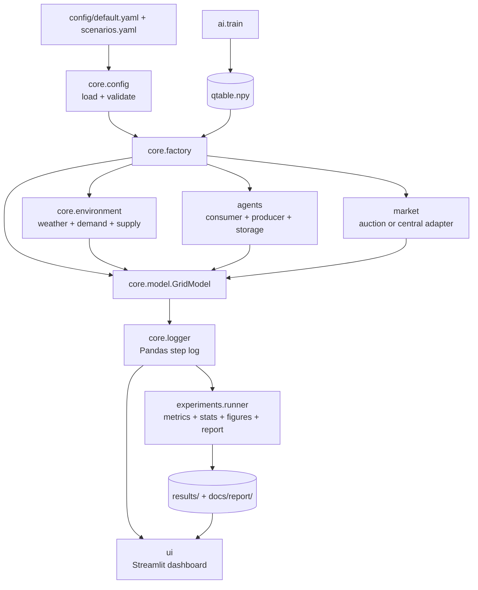
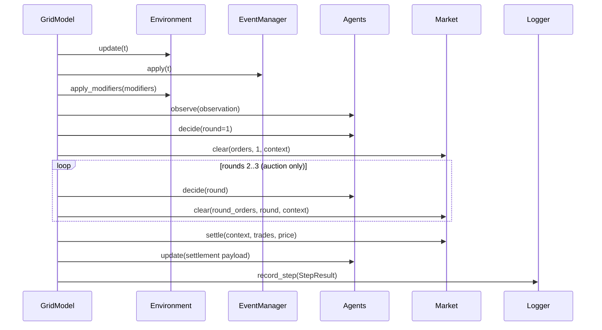

# GridMind — Complete Technical Documentation

**Status:** Post-audit reference for the working tree.
**Audit date:** 2026-11-25.
**Scope:** The complete simulation, market, optimisation, learning, experiment and dashboard stack implemented in this repository.
**Grounding rule:** Every statement below is derived from the source code, the configuration files and the executed test suite. Items that could not be verified from the repository are explicitly marked **UNKNOWN** or **NOT EXECUTED**.

---

## 1. What GridMind is

GridMind is a synthetic, hour-by-hour electricity-market simulator for a small city. Autonomous consumers, producers and batteries trade energy. The same physical scenario is run under four comparison systems:

| System id | Market mechanism | Replanning / policy |
| --- | --- | --- |
| `central_6h` | Central linear-programming dispatch | Re-optimise every 6 simulated hours, execute the cached plan in between |
| `central_1h` | Central linear-programming dispatch | Re-optimise every simulated hour |
| `auction` | Uniform-price double auction with up to 3 negotiation rounds | Rule-based battery policy |
| `auction_q` | Same auction | Tabular Q-learning battery policy loaded from `qtable.npy` |

The research question implemented by the experiment pipeline is:

> Is decentralised negotiation between autonomous agents more robust than centralised planning when power plants fail or demand suddenly increases?

The project is intentionally a **model**, not a digital twin of a real grid. It has no network topology, unit-commitment, ramping, reserves, frequency dynamics, real weather data or real market data. Those omissions are limitations, not hidden features.

---

## 2. Repository map

| Path | Responsibility |
| --- | --- |
| `config/default.yaml` | Every tunable parameter: fleet, prices, VOLL, environment, Q-learning, experiment grid |
| `config/scenarios.yaml` | The five official disruption scenarios |
| `core/config.py` | YAML loading, strict validation, official constants, random-stream derivation |
| `core/clock.py` | Monotonic 168-hour clock and hour/day mapping |
| `core/weather.py` | Temperature, cloud and wind processes; noiseless forecast |
| `core/demand.py` | Residential, factory and hospital demand; realised noise and expected forecast |
| `core/supply.py` | Solar, wind, thermal and peaker availability |
| `core/events.py` | Event definitions, event manager, environment modifiers |
| `core/environment.py` | Composition of weather, demand and supply; event application; forecast |
| `core/model.py` | `GridModel` orchestration, `StepResult`, observation and market-context construction |
| `core/logger.py` | Pandas step log and long-format per-agent detail log |
| `core/factory.py` | Assembles a complete model for a given system, seed and scenario |
| `agents/base.py` | `BaseAgent` contract and the labelled mock agent |
| `agents/consumer.py` | Hospital, residential and factory bidding agents |
| `agents/producer.py` | Solar, wind, thermal and peaker offering agents |
| `agents/storage.py` | Battery physics and the pluggable storage-policy interface |
| `market/orders.py` | Frozen `Order` and `Trade` value objects |
| `market/auction.py` | Double auction, clearing result, settlement |
| `market/negotiation.py` | Round validation and deterministic ordering |
| `ai/central_lp.py` | Central LP planner, `DispatchPlan`, market adapter |
| `ai/qlearning.py` | 60-state tabular Q-learning and greedy policy |
| `ai/train.py` | Offline training loop and artefact persistence |
| `experiments/runner.py` | 600-run grid, per-run CSVs, aggregates, metadata |
| `experiments/metrics.py` | Official per-run metrics |
| `experiments/stats.py` | Bootstrap intervals, paired Wilcoxon tests, Bonferroni correction |
| `experiments/plots.py` | Six static report figures |
| `experiments/report.py` | Markdown report generation |
| `ui/` | Four-page Streamlit dashboard and artefact loaders |
| `tests/` | 151 automated tests (see §14) |

---

## 3. Architecture and execution order

### 3.1 Component graph



### 3.2 One simulated hour

`GridModel._execute_step()` (`core/model.py:359-428`) runs nine stages in a fixed order:

1. **Environment update** — `Environment.update(t)` draws weather and realised demand for hour `t`, and computes available generation.
2. **Events apply** — `EventManager.apply(t)` records activation/expiry transitions and returns merged `EnvironmentModifiers`.
3. **Modifiers apply** — `Environment.apply_modifiers()` scales realised demand and generation and can override cloud cover.
4. **Agents observe** — each agent receives a read-only observation. Agents never see event names, only environmental consequences.
5. **Round 1 decisions** — every agent submits orders for round 1.
6. **Market clearing** — the auction or central adapter clears round 1.
7. **Negotiation rounds 2..3** — auction modes only; agents re-submit round-aware counter-offers and the market clears each round. Central modes skip this stage because the adapter owns the whole dispatch.
8. **Settlement** — the final trades become unserved/deferred energy and zero-sum payments.
9. **Agent updates and logging** — each agent receives its settlement, then the immutable `StepResult` is logged.

A Mermaid sequence view:



### 3.3 Frozen data structures

`StepResult` (`core/model.py:65-96`) is immutable and contains:

| Field | Unit | Meaning |
| --- | --- | --- |
| `t` | step | Absolute hour index, `0..167` |
| `price` | currency/MWh | Final clearing price |
| `supply_mw` | MW | Total **available** generation (not dispatched) |
| `demand_mw` | MW | Total **metered** demand |
| `unserved` | MW per consumer | Energy left unserved |
| `deferred` | MW per consumer | Flexible energy shifted to the next hour |
| `trades` | list[`Trade`] | Trades of the final round |
| `orders` | list[`Order`] | All orders from all rounds |
| `messages` | count | Number of orders exchanged |
| `soc` | ratio per battery | State of charge after the step |
| `generation` | MW per producer | Available generation per producer |

`Order` and `Trade` are frozen value objects (`market/orders.py`). The auction sorts bids by descending price, then **ascending** priority (lower number = more important), then agent id. Consumers use hospital `1`, residential `2`, factory `3`, flexible `4`; producers and storage use `4`.

---

## 4. Configuration and validation

### 4.1 Official constants

`core/config.py:29-44` hard-codes the study boundaries so that a malformed configuration fails loudly:

| Constant | Value | Meaning |
| --- | --- | --- |
| `REQUIRED_SIMULATION_STEPS` | `168` | Seven days of hourly steps |
| `MAX_NEGOTIATION_ROUNDS` | `3` | Auction rounds 1..3 |
| `REQUIRED_SEED_COUNT` | `30` | Seeds per system/scenario cell |
| `MAX_AGENT_COUNT` | `20` | Fleet cap |
| `DEFAULT_AGENT_COUNT` | `15` | Default fleet size |
| `OFFICIAL_SYSTEMS` | `central_6h`, `central_1h`, `auction`, `auction_q` | Four comparison systems |
| `OFFICIAL_SCENARIOS` | `normal`, `plant_outage`, `demand_spike`, `weather_shift`, `combined` | Five scenarios |

`validate_config()` checks every section, rate, fleet boundary, scenario timing and the agent cap before any object is built. `load_config()` merges `config/default.yaml` with the scenario catalogue and returns one validated dictionary.

### 4.2 Default fleet and prices

| Group | Count | Key parameters |
| --- | --- | --- |
| Solar | 1 | 40 MW, marginal cost 5 |
| Wind | 1 | 30 MW, marginal cost 8 |
| Thermal | 1 | 50 MW, marginal cost 45, capacity factor 1.0 |
| Peaker | 1 | 20 MW, marginal cost 90, capacity factor 1.0 |
| Hospital | 2 | 6 MW base, flexibility 0, VOLL 1000, ceiling 300 |
| Residential | 4 | 8 MW base, flexibility 0.1, VOLL 100, ceiling 120 |
| Factory | 3 | 10 MW base, flexibility 0.2, VOLL 40, ceiling 80 |
| Battery | 2 | 20 MWh, 5 MW rate, efficiency 0.95, initial SoC 0.5 |

Total default agents: `1+1+1+1 + 2+4+3 + 2 = 15`. The flexible-order ceiling is 50 currency/MWh.

### 4.3 Deterministic random streams

`derive_rng(seed, stream)` creates `numpy.random.default_rng(SeedSequence([seed, stream]))`. Each independent component owns a stream index:

| Stream | Index | Owner |
| --- | --- | --- |
| `STREAM_WEATHER_CLOUD` | `0` | Cloud AR(1) process |
| `STREAM_WEATHER_WIND` | `1` | Wind AR(1) process |
| `STREAM_WEATHER_TEMPERATURE` | `2` | Daily temperature offsets |
| `STREAM_DEMAND` | `100` | Reserved demand stream constant |
| `STREAM_AGENT_BASE` | `1000` | Base for realised per-agent demand noise |
| `STREAM_AGENT_FORECAST_BASE` | `2_000_000` | Base for per-agent **forecast** noise |
| `QLEARNING_STREAM` | `7000` | Exploration draws in the Q-learner |
| `TRAINING_STREAM` | `7001` | Training scenario schedule |

Per-agent stream indices are derived from a BLAKE2s digest of the agent id (`agent_stream_index`), so adding or reordering agents never shifts another agent's draws. The forecast and realised-demand streams are deliberately different: a consumer's forecast error is not the exact shock that the environment applies in the same hour.

---

## 5. Environment subsystem

### 5.1 Weather (`core/weather.py`)

Temperature:

$$
T(t) = T_{\text{base}} + A \sin\!\left(\frac{2\pi(\text{hour}(t) - \phi)}{24}\right) + \varepsilon_{\text{day}},
\qquad \varepsilon_{\text{day}} \sim \mathcal{N}(0, \sigma_{\text{day}}^2)
$$

Cloud and wind are clipped AR(1) processes:

$$
c_t = \operatorname{clip}\!\left(\rho_c c_{t-1} + (1-\rho_c)U(\ell_c, h_c),\; c_{\min}, c_{\max}\right)
$$

$$
w_t = \operatorname{clip}\!\left(\rho_w w_{t-1} + (1-\rho_w)U(\ell_w, h_w),\; 0, 1\right)
$$

Clear-sky solar profile:

$$
s(h) =
\begin{cases}
\max\!\left(0, \sin\!\left(\frac{\pi(h - h_{\text{start}})}{d}\right)\right), & h_{\text{start}} \le h < h_{\text{start}} + d,\\
0, & \text{otherwise}
\end{cases}
$$

Defaults: `T_base = 27 °C`, `A = 8 °C`, `peak_shift = 9`, `σ_day = 2`, `ρ_c = 0.8`, `ρ_w = 0.9`, `solar_window = [6, 18)`.

The forecast path uses the expected value of the AR(1) process and a zero day-offset for future days. It contains no random draws and no knowledge of future events.

### 5.2 Demand (`core/demand.py`)

Expected demand:

$$
D^{\text{res}}(h,T) = B_{\text{res}} \, P_{\text{res}}(h) \, \bigl(1 + \kappa \max(0, T - T_{\text{comfort}})\bigr)
$$

$$
D^{\text{fac}}(h) =
\begin{cases}
B_{\text{fac}}, & h \in [8,18),\\
0.4\,B_{\text{fac}}, & \text{otherwise}
\end{cases}
\qquad
D^{\text{hosp}}(h) = B_{\text{hosp}}
$$

Residential profile windows: night `0.6` (`[22,7)`), morning `1.2` (`[7,9)`), midday `0.8` (`[9,18)`), evening `1.4` (`[18,22)`). `κ = 0.02`, `T_comfort = 25 °C`.

Realised demand:

$$
D_i(t) = \max\!\left(0,\; D_i^{\text{expected}}(t)\,(1 + \varepsilon_i)\right),
\qquad \varepsilon_i \sim \mathcal{N}(0, \sigma_{\text{type}(i)}^2)
$$

with `σ_residential = 0.05`, `σ_factory = 0.03`, `σ_hospital = 0.02`. Event demand multipliers are applied **after** the draw, so an event does not consume a second random number.

The consumer **agent** then applies its own forecast error:

$$
\hat{D}_i(t) = \max\!\left(0,\; D_i(t)\,(1 + \eta_i)\right),
\qquad \eta_i \sim \mathcal{N}(0, 0.03^2)
$$

For hospitals, `η_i` is clipped to non-negative so a hospital never deliberately under-bids metered demand. The agent's bid is `D̂_i(t)` plus any flexible energy deferred from the previous hour.

### 5.3 Supply (`core/supply.py`)

$$
G_{\text{solar}} = C_{\text{solar}} \cdot s(h) \cdot c_{\text{effective}}
$$

$$
G_{\text{wind}} = C_{\text{wind}} \cdot w
$$

$$
G_{\text{thermal}} = C_{\text{thermal}} \cdot \text{capacity\_factor},
\qquad
G_{\text{peaker}} = C_{\text{peaker}} \cdot \text{capacity\_factor}
$$

Event capacity factors multiply the result by producer id or producer type.

> **Calibration note (intentional, not a bug).** The implemented solar equation multiplies by `cloud_cover`, so a *lower* cloud value reduces solar output. The `weather_shift` scenario sets `cloud_override: 0.2`, which therefore reduces solar output under this equation. The variable is best read as a **solar availability factor**, not a meteorological cloud fraction. Changing the equation would change the calibrated scenario semantics and was deliberately not done in the audit.

### 5.4 Scenarios (`config/scenarios.yaml`)

| Scenario | Event | Window | Modifiers |
| --- | --- | --- | --- |
| `normal` | none | — | — |
| `plant_outage` | `thermal_outage` | steps `[86, 98)` | thermal capacity factor `0.3` |
| `demand_spike` | `residential_spike` | steps `[86, 92)` | residential demand `×1.4` |
| `weather_shift` | `weather_shift` | steps `[72, 96)` | cloud override `0.2`, wind capacity factor `0.5` |
| `combined` | `combined_outage` + `combined_spike` | `[86, 98)` and `[86, 92)` | thermal `0.3`; residential `×1.4` |

Events are active on the half-open interval `[start, start + duration)`. They never message agents directly; only demand multipliers, capacity factors and cloud overrides reach the environment.

---

## 6. Agents

### 6.1 Contract (`agents/base.py`)

Every agent implements:

| Method | When | Purpose |
| --- | --- | --- |
| `observe(obs)` | Once per hour, before decisions | Validate and store the observation |
| `decide(round)` | Once per negotiation round | Return a list of `Order` objects |
| `update(result)` | Once per hour, after settlement | Store the settlement and update internal state |
| `snapshot()` | On demand | Return JSON-serialisable public state |

### 6.2 Consumers (`agents/consumer.py`)

A consumer receives metered demand, applies its own forecast error, adds deferred energy from the previous hour, and splits the result into fixed and flexible parts:

$$
\text{fixed} = \hat{D}(1 - f), \qquad \text{flex} = \hat{D} f
$$

| Part | Priority | Price in round 1 | Price in round `r` |
| --- | --- | --- | --- |
| Fixed | hospital 1 / residential 2 / factory 3 | Type ceiling | `min(ceiling, ceiling · 1.2^{r-1})` |
| Flexible | 4 | `max_prices.flex = 50` | `min(50, 50 · 1.2^{r-1})` |

Hospitals have `f = 0`; residential `f = 0.1`; factory `f = 0.2`.

### 6.3 Producers (`agents/producer.py`)

A producer offers its entire available generation:

$$
p_{\text{base}} = mc \,(1 + m), \qquad
p_r =
\begin{cases}
p_{\text{base}}, & r = 1,\\
\max\!\left(mc,\; p_{\text{base}} (1 - \delta)^{r-1}\right), & r > 1,
\end{cases}
$$

with initial markup `m = 0.2` and `δ = 0.05`. After settlement:

$$
m \leftarrow
\begin{cases}
\min(1, m + 0.05), & \text{sold} \ge 0.95 \cdot \text{available},\\
\max(0, m - 0.05), & \text{otherwise}.
\end{cases}
$$

Producers never ask below marginal cost in a later round.

### 6.4 Storage (`agents/storage.py`)

Battery state of charge (ratio in `[0,1]`):

$$
soc_{t+1} = \operatorname{clip}\!\left(soc_t + \frac{\eta \cdot \text{bought}_t - \text{sold}_t/\eta}{C},\; 0,\; 1\right)
$$

Charge and discharge are limited by power rate and energy headroom:

$$
\text{max charge} = \min\!\left(P_{\max},\; \frac{(1-soc)C}{\eta}\right),
\qquad
\text{max discharge} = \min\!\left(P_{\max},\; soc \cdot C \cdot \eta\right)
$$

The default rule policy charges when `last_price < 0.85 · avg_price_24h`, discharges when `last_price > 1.15 · avg_price_24h`, and waits otherwise.

**Post-audit timing invariant.** The policy is queried **once per simulated hour**, not once per negotiation round. `StorageAgent.decide()` caches the action in `_step_action` and reuses it for rounds 2 and 3. This prevents a learning policy from closing several transitions for the same state and attributing the whole step reward to the last round.

**Post-audit price-history invariant.** The latest clearing price is appended in `_on_update()` at the end of the hour, not in `_on_observe()`. `GridModel` snapshots agents before calling `observe()`, so appending during observation would make the policy's `avg_price_24h` lag by one hour.

---

## 7. Market subsystem

### 7.1 Double auction (`market/auction.py`)

Bids are sorted by `(-price, priority, agent_id)`; asks by `(price, priority, agent_id)`. The auction walks the two lists while the best bid is at least the best ask:

```text
while bid_index < len(bids) and ask_index < len(asks)
      and bids[bid_index].price >= asks[ask_index].price:
    q = min(remaining_bid, remaining_ask)
    match(bid, ask, q)
    remember last_bid_price, last_ask_price
```

If at least one match occurred:

$$
p = \frac{p_{\text{last bid}} + p_{\text{last ask}}}{2}
$$

Otherwise the previous clearing price is kept. Every trade in the round uses the same uniform price `p`. This is a midpoint uniform-price rule, not a Vickrey or pay-as-bid auction.

### 7.2 Settlement

For each consumer `i`:

$$
\text{shortfall}_i = \max(0, D_i - \text{bought}_i)
$$

$$
\text{deferred}_i = \min(\text{shortfall}_i,\; f_i D_i)
$$

$$
\text{unserved}_i = \text{shortfall}_i - \text{deferred}_i
$$

Deferred energy is re-bid once in the next hour. Payments are zero-sum:

$$
\text{payment}_{\text{buyer}} \mathrel{+}= q p, \qquad
\text{payment}_{\text{seller}} \mathrel{-}= q p
$$

**Accounting nuance.** If a deferred quantity fails to clear again in the next hour, the environment's metered demand in that next hour does not include the re-bid, so the failed rebound is not counted again in `unserved`. This is a documented modelling limitation of the settlement definition, not a hidden double count.

### 7.3 Negotiation (`market/negotiation.py`)

`RaiseFactorNegotiation.refine()` validates that every order belongs to the current round and that buy prices do not exceed the published consumer ceiling. It returns orders sorted deterministically by `(side, agent_id, priority)`. Agents own their own counter-offer rules; the protocol does not invent prices.

---

## 8. Central planning

### 8.1 LP formulation (`ai/central_lp.py`)

For a horizon of `H` hours, the planner solves one linear program with these variables per hour `τ`:

| Variable | Bounds | Meaning |
| --- | --- | --- |
| `g[k,τ]` | `[0, availability[k,τ]]` | Dispatched generation of producer `k` |
| `u[i,τ]` | `[0, demand[i,τ]]` | Unserved energy of consumer `i` |
| `ch[s,τ]` | `[0, rate_s]` | Battery charging power |
| `dis[s,τ]` | `[0, rate_s]` | Battery discharging power |
| `soc[s,τ]` | `[0, capacity_s]` | Battery energy after hour `τ` |

Objective:

$$
\min \sum_{\tau=1}^{H}
\left[
\sum_k mc_k\, g_{k,\tau}
+ \sum_i \mathrm{VOLL}_i\, u_{i,\tau}
+ 10^{-6}\sum_s (ch_{s,\tau} + dis_{s,\tau})
\right]
$$

Hourly energy balance:

$$
\sum_k g_{k,\tau} + \sum_s dis_{s,\tau} - \sum_s ch_{s,\tau} + \sum_i u_{i,\tau}
= \sum_i demand_{i,\tau}
$$

Battery dynamics:

$$
soc_{s,\tau} - soc_{s,\tau-1} - \eta_s ch_{s,\tau} + \frac{dis_{s,\tau}}{\eta_s} = 0,
\qquad soc_{s,-1} = soc_s^{\text{initial}} C_s
$$

The tiny `1e-6` charge/discharge cost breaks ties without materially changing the economic objective.

### 8.2 Why central dispatch sheds factory load

The default VOLL ordering is hospital `1000` > residential `100` > factory `40`, while thermal marginal cost is `45`. When thermal generation is the marginal source, the LP prefers to leave factory load unserved (penalty `40`) rather than burn thermal fuel (`45`) to serve it. This is **intentional model behaviour** under the configured VOLL values, not an accounting error. It lowers central social cost but means central and auction systems are not compared on identical served energy.

### 8.3 Adapter execution semantics (`CentralMarketAdapter._execute`)

The cached plan is a forecast. At execution time the adapter reconciles it with actual conditions:

1. **Generation** is `min(plan generation, actual available generation)`; unexpected surplus is curtailed.
2. **Discharge** is clipped by `min(rate, soc_mwh · η)`.
3. **Planned charge** is clipped by `min(rate, headroom_mwh / η)`.
4. Let `supply = Σ generation + Σ discharge` and `demand = Σ actual demand`.
   * If `demand ≥ supply`: charge is forced to zero and `available = supply`.
   * Otherwise: `surplus = supply - demand`; each battery charges at most its planned charge and at most the surplus; total charge is scaled down if necessary; `available = supply - total charge`.
5. Consumers are served in **descending VOLL** order (hospital last cut). Charging uses only leftover surplus, so a planned charge can never starve load.
6. Sellers are generation units sorted by marginal cost, then batteries at the flexible ceiling. Buyers are served consumers in VOLL order, then charging batteries.
7. The uniform central price is the **maximum marginal cost among sellers that actually matched**, not among all dispatched or available units. If nothing matched, the previous price is kept.

**Limitation.** This price is a marginal-cost proxy, not the dual variable of the LP. It is internally consistent and avoids letting curtailed units set the price, but it is not an economic equilibrium price.

### 8.4 Replanning

`CentralMarketAdapter._needs_replan()` replans when there is no cached plan, when the requested hour is outside the cached horizon, or when `(t - origin) % interval == 0`. `central_1h` uses `interval = 1`; `central_6h` uses `interval = simulation.horizon = 6`. Between replans the cached plan is executed with the clipping rules above.

---

## 9. Tabular Q-learning

### 9.1 State space

The state is the Cartesian product of:

| Component | Bins | Definition |
| --- | --- | --- |
| State of charge | 5 | `floor(soc_mwh / (capacity/5))`, clipped to `0..4` |
| Price | 3 | cheap if `last/avg < 0.85`, expensive if `> 1.15`, else normal |
| Period | 4 | `hour // 6` (night, morning, midday, evening) |

Flat index:

$$
s = (\,soc\_bin \cdot 3 + price\_bin\,) \cdot 4 + period\_bin \in [0, 59]
$$

The table therefore has shape `(60, 3)`.

### 9.2 Actions and reward

Actions: `0 = wait`, `1 = charge`, `2 = discharge`.

Per-hour reward for a battery:

$$
r = p\,\text{sold} - p\,\text{bought} - 0.5(\text{bought} + \text{sold})
- 0.5 \cdot \text{system\_unserved} \cdot \mathbb{1}[soc < 1]
$$

The last term penalises unserved energy only while the battery is not full, encouraging the battery to preserve headroom during scarcity.

### 9.3 Update rule

$$
Q(s,a) \leftarrow Q(s,a) + \alpha\left[r + \gamma \max_{a'} Q(s',a') - Q(s,a)\right]
$$

with `α = 0.1`, `γ = 0.95`. At the terminal transition the bootstrap term is zero. Exploration is ε-greedy with a linear schedule from `1.0` to `0.05` over the first `1500` episodes.

### 9.4 Training loop (`ai/train.py`)

* `2000` episodes by default, each `168` steps.
* Each episode samples one official scenario uniformly and uses seed `1000 + episode`.
* All non-storage agents keep their rule-based behaviour.
* All batteries in one episode share one `TabularQAgent` learner.
* The policy is queried once per hour, so one transition is closed per hour; `end_episode()` closes the terminal transition.
* Artefacts: `qtable.npy` (shape `(60,3)`), `results/learning_curve.csv` (50-episode windows), `results/training_metadata.json`.

---

## 10. Experiment pipeline

### 10.1 Grid

`build_experiment_grid()` enumerates systems × scenarios × seeds in deterministic order. The official grid is `4 × 5 × 30 = 600` runs, each `168` steps, for `100,800` step rows. `ExperimentSpec.experiment_id` is `"{system}__{scenario}__seed{seed}"`.

### 10.2 Runner artefacts

| File | Content |
| --- | --- |
| `runs/<experiment_id>.csv` | One run's step log |
| `raw.csv` | One metrics row per run |
| `steps.csv` | All step rows with `system`, `scenario`, `seed` |
| `metrics_summary.csv` | Mean, SD, bootstrap CI, min, max per scenario/system/metric |
| `stats_pairwise.csv` | Paired Wilcoxon tests with Bonferroni correction |
| `figures/fig1..fig6*.png` | Six report figures |
| `run_metadata.json` | Run count, systems, scenarios, seeds, timing, Q-table and curve paths |
| `REPORT.md` | Markdown report |

**Report path safety (post-audit).** A full official grid written to `results/` writes `docs/report/REPORT.md`. Any filtered or alternative-output run writes `REPORT.md` inside its own output directory. An explicit `report_path` overrides both. This prevents a smoke run from overwriting the delivered report.

### 10.3 Metrics (`experiments/metrics.py`)

| Metric | Formula |
| --- | --- |
| `generation_cost` | `Σ_producers mc_k · Σ_t sold_{k,t}` |
| `voll_penalty` | `Σ_consumers VOLL_i · Σ_t ue_{i,t}` |
| `social_cost` / `cost_total` | `generation_cost + voll_penalty` |
| `cost_mean_per_mwh` | `social_cost / Σ_t served_t`, `served_t = max(0, demand_t - unserved_t - deferred_t)` |
| `ue_total` | `Σ_t Σ_i ue_{i,t}` |
| `deferred_energy_mwh` | `Σ_t Σ_i deferred_{i,t}` |
| `ue_hospital` / `ue_residential` / `ue_factory` | Sum of UE by consumer type |
| `hospital_outage_hours` | Number of hours with any hospital UE `> 0.001` |
| `price_mean` | `mean(price_t)` |
| `price_volatility` | `std(price_t, ddof=1)` |
| `par` | `max_t served_t / mean_t served_t` (0 if mean ≤ 0) |
| `gini` | `Σ_i Σ_j |p_i - p_j| / (2 n² mean(p))`, `p_i = paid_i / bought_i` |
| `recovery_time` | First run of 3 consecutive hours with price within 10 % of the pre-event 24-hour mean and UE ≤ 0.001; otherwise `steps - start` (censored) |
| `messages` | `Σ_t messages_t` |
| `renewable_share` | `Σ_t (sold_solar + sold_wind) / Σ_t sold_all_producers` |
| `self_sufficiency` | `1 - ue_total / demand_total` |
| `storage_cycles` | `Σ_batteries (Σ_t bought + Σ_t sold) / (2 · capacity)` |

`recovery_time` returns `offset - start - 2` when recovery is detected, so the first stable hour is counted as hour 0 of recovery.

### 10.4 Statistics (`experiments/stats.py`)

* Mean and sample standard deviation (`ddof=1`) over seeds.
* 95 % bootstrap confidence interval with `1000` resamples and fixed seed `20_240_517`.
* Paired two-sided Wilcoxon signed-rank test on non-zero differences (`zero_method="wilcox"`).
* Bonferroni correction over **all** pairwise rows: `p_adj = min(1, p · m)`, where `m` is the number of comparisons across systems, scenarios and metrics.
* Effect size: `(mean_treatment - mean_baseline) / |mean_baseline|`.

### 10.5 Figures and report

Six Matplotlib figures: social cost with error bars, price in the plant-outage scenario, unserved energy around the outage, the Q-learning curve, the Q-table policy heatmap, and social-cost box plots. The Markdown report is assembled from the actual tables; hypothesis verdicts are descriptive and state when a difference is not significant.

---

## 11. Dashboard

The Streamlit app has four pages:

| Page | Source | Purpose |
| --- | --- | --- |
| Live Simulation | Live `GridModel` | Step/play/reset, network, environment, event timeline, price/supply/demand/SoC history |
| Market Board | Live `GridModel` snapshot | Order depth, rounds, net positions, supply mix, messages, trades |
| Compare | `results/raw.csv`, summary, pairwise, figures | Filtered 600-run comparison and statistical tables |
| Learning | `qtable.npy`, curve, metadata | Policy heatmap, state explorer, rule-vs-Q evidence |

The dashboard never writes experiment artefacts and never invents values. Missing files produce explicit empty/error states with the command needed to regenerate them. `ui/state.py` rebuilds the live model when the `(mode, scenario, seed, fleet)` signature changes and converts build/step exceptions into visible UI state.

**Snapshot semantics.** `GridModel.snapshot()["t"]` is the **next** hour to execute, while `price`, `unserved`, `deferred` and the log rows describe the **last completed** hour. The dashboard labels this as progress (`t / steps`) and shows the last clearing result. This is intentional and tested.

---

## 12. Reproducibility

A run is fully determined by `(config, seed, mode, scenario, qtable)`:

* All randomness uses `derive_rng(seed, stream)`; no global NumPy or Python random state is used.
* Per-agent streams are derived from stable agent ids, not ordinal positions.
* Forecast paths consume no random numbers.
* The same seed and configuration reproduce identical logs; the test suite verifies full 168-step equality.
* The Q-table is an external artefact; `auction_q` results depend on the exact `qtable.npy` used.

Commands:

```bat
.venv\Scripts\python.exe -m pytest -q
.venv\Scripts\python.exe -m ai.train
.venv\Scripts\python.exe -m experiments.runner --seeds 30
.venv\Scripts\streamlit.exe run ui/app.py
```

Smoke run without touching official artefacts:

```bat
.venv\Scripts\python.exe -m experiments.runner --seeds 1 ^
  --systems auction central_1h --scenarios normal ^
  --output C:\temp\gm_smoke
```

---

## 13. Post-audit behaviour changes

The audit fixed these correctness issues; the full root-cause table is in `docs/GRIDMIND_AUDIT_REPORT.md`.

| Area | Before | After |
| --- | --- | --- |
| Central execution | Charging could consume energy needed by load; served quantity could be subtracted twice | Load is served first; charging uses only surplus |
| Central storage | Cached plan ignored actual SoC/headroom | Charge/discharge clipped to physical limits at execution |
| Central price | Could be set by curtailed generation | Uses only matched sellers |
| Consumer forecast | Forecast noise shared the realised-demand stream | Independent forecast stream |
| Storage policy | Queried once per negotiation round | Queried once per hour |
| Storage price history | Appended after the observation snapshot | Appended at settlement, so `avg_price_24h` is current |
| `DispatchPlan.objective` | Whole-horizon total copied into every hour | Per-hour objective slice; sums to the horizon total |
| Runner report | Always wrote `docs/report/REPORT.md` | Official full grid only; filtered runs write locally |
| Runner curve | Always loaded the global curve | Loads the run directory first, then falls back; path recorded in metadata |
| Report prose | Hard-coded “360 tests” | Dynamic Bonferroni test count |

---

## 14. Test suite

Executed on 2026-11-25:

```text
151 passed in 3.94s
```

| File | Tests | Focus |
| --- | --- | --- |
| `tests/test_config.py` | 31 | Loading, validation, agent resolution, seed streams |
| `tests/test_model.py` | 24 | Orchestration, observations, events, snapshot, energy conservation, price-history integration |
| `tests/test_environment.py` | 17 | Weather, demand, supply, forecasts, event modifiers |
| `tests/test_market.py` | 13 | Auction, settlement, negotiation, central planner and adapter execution |
| `tests/test_agents.py` | 12 | Consumer/producer/storage behaviour, policy timing, forecast streams |
| `tests/test_clock.py` | 11 | Clock arithmetic and boundaries |
| `tests/test_experiments.py` | 11 | Metrics, statistics, runner, report path safety |
| `tests/test_ai.py` | 10 | State discretisation, Q-updates, training policy |
| `tests/test_logger.py` | 7 | Step log and detail log |
| `tests/test_factory.py` | 6 | Model assembly for every system |
| `tests/test_reproducibility.py` | 6 | Identical logs, seed sensitivity, global RNG independence |
| `tests/test_contracts.py` | 3 | Frozen `Order`/`Trade`/`StepResult` constraints |

**New regression tests added by the audit (11):**

* `test_central_execution_serves_load_before_charging`
* `test_central_execution_never_charges_while_load_is_unserved`
* `test_central_execution_clips_charge_to_physical_headroom`
* `test_central_execution_clips_discharge_to_available_energy`
* `test_central_price_excludes_curtailed_generation`
* `test_central_plan_objectives_sum_to_the_horizon_total`
* `test_storage_policy_is_queried_once_per_hour_across_rounds`
* `test_storage_price_history_records_the_settled_price`
* `test_consumer_forecast_noise_uses_an_independent_stream`
* `test_storage_policy_observation_includes_the_latest_clearing_price`
* `test_partial_run_report_never_overwrites_the_official_report`

**Executed during the audit:** the full pytest suite; a two-run smoke pipeline (`auction` and `central_1h`, `normal`, seed 0) into a temporary directory; targeted probes of central execution and storage price history.

**Not executed during the audit:** a fresh 2000-episode Q-training run; a fresh official 600-run grid; a manual Streamlit browser session; any external-data validation. Existing artefacts in `results/` and `qtable.npy` predate the audit fixes and were not overwritten.

---

## 15. Known limitations and intentional assumptions

1. **No network model.** A single copper-plate market; no transmission limits, losses or locational prices.
2. **No unit commitment or ramping.** Thermal and peaker output can change hour to hour without start-up costs or minimum stable generation.
3. **No reserves or frequency dynamics.** Reliability is measured only as unserved energy and price recovery.
4. **Synthetic data only.** Weather and demand are stochastic equations, not measured traces. No external validity claim is possible.
5. **Central factory shedding.** With VOLL `40` and thermal cost `45`, the LP rationally sheds factory load. Central systems are therefore not compared on identical served energy.
6. **Censored central recovery.** The standing factory shortfall prevents central price/UE from returning to the pre-event band, so `recovery_time` is often `steps - start` (the end of the window), not a measured recovery.
7. **Solar cloud factor.** The equation multiplies by cloud cover; a lower override reduces output. This is the calibrated meaning of the variable.
8. **Auction deferred accounting.** Deferred flexible energy is re-bid once; a failed rebound is not re-counted in UE because settlement compares against the next hour's metered demand.
9. **Central price proxy.** The uniform price is the maximum matched marginal cost, not the LP dual.
10. **Snapshot semantics.** `snapshot()["t"]` is the next hour; the displayed price/UE are from the last completed hour.
11. **Stale artefacts.** The delivered `results/` and `qtable.npy` were generated before the audit fixes. Re-run training and the 600-run grid to obtain post-fix numbers.
12. **Partial-run aggregate risk.** A filtered run pointed at `results/` still overwrites `raw.csv`, `steps.csv`, `metrics_summary.csv` and `stats_pairwise.csv`; only the official report path is protected automatically.
13. **Battery model.** Linear efficiency, no degradation, no temperature dependence, no minimum/maximum state-of-charge band beyond `[0,1]`.
14. **Q-learning scope.** Tabular, 60 states, one shared learner across batteries, no hyperparameter sweep, no deep RL.
15. **Statistical scope.** Thirty paired seeds per cell; Bonferroni is conservative; significance measures consistency, not practical importance.
16. **Mock mode.** `mode="mock"` exists for orchestration tests and must never be used for reported results.

---

## 16. File-level reference

| Concern | Primary file and symbol |
| --- | --- |
| Step order | `core/model.py::GridModel._execute_step` |
| Observations | `core/model.py::GridModel._build_observations` |
| Market context | `core/model.py::GridModel._build_market_context` |
| Settlement payload | `core/model.py::GridModel._update_agents` |
| Weather | `core/weather.py::WeatherModel` |
| Demand | `core/demand.py::DemandModel` |
| Supply | `core/supply.py::SupplyModel` |
| Events | `core/events.py::EventManager`, `EnvironmentModifiers` |
| Consumer bidding | `agents/consumer.py::ConsumerAgent.decide` |
| Producer markup | `agents/producer.py::ProducerAgent._on_update` |
| Storage physics | `agents/storage.py::StorageAgent._on_update` |
| Storage policy timing | `agents/storage.py::StorageAgent.decide` |
| Auction | `market/auction.py::DoubleAuction.clear` |
| Settlement | `market/auction.py::DoubleAuction.settle` |
| Central LP | `ai/central_lp.py::CentralLPPlanner._solve` |
| Central execution | `ai/central_lp.py::CentralMarketAdapter._execute` |
| Q-learning | `ai/qlearning.py::TabularQAgent.update` |
| Training | `ai/train.py::train_storage_policy` |
| Metrics | `experiments/metrics.py::compute_run_metrics` |
| Statistics | `experiments/stats.py::pairwise_comparisons` |
| Runner | `experiments/runner.py::ExperimentRunner.run_all` |
| Report | `experiments/report.py::write_report` |
| Dashboard lifecycle | `ui/state.py::ensure_model` |

---

## 17. Glossary

| Term | Meaning |
| --- | --- |
| **VOLL** | Value of lost load, currency per MWh of unserved energy |
| **UE** | Unserved energy |
| **PAR** | Peak-to-average ratio of served demand |
| **SoC** | Battery state of charge, a ratio in `[0,1]` |
| **Uniform price** | Every trade in a round clears at the same price |
| **Deferred energy** | Flexible demand shifted to the next hour instead of being shed |
| **Censored recovery** | Recovery time equal to the remaining event window because the system never returns to baseline |
| **Marginal cost** | Fuel cost of the most expensive matched unit in central dispatch |
| **Seed stream** | Independent NumPy generator derived from `(seed, stream_index)` |
